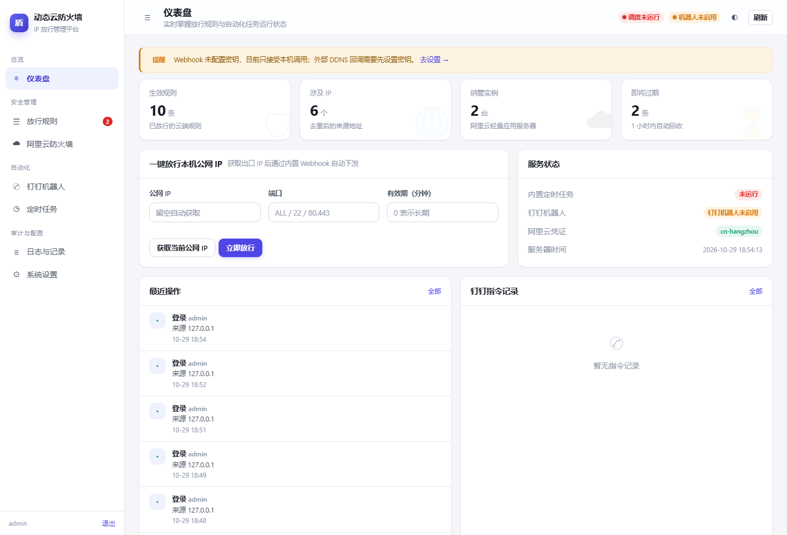
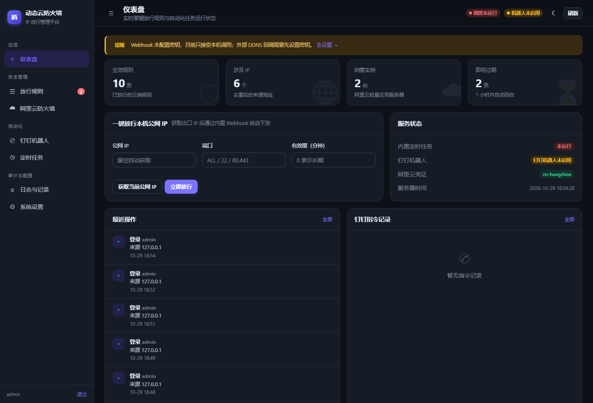
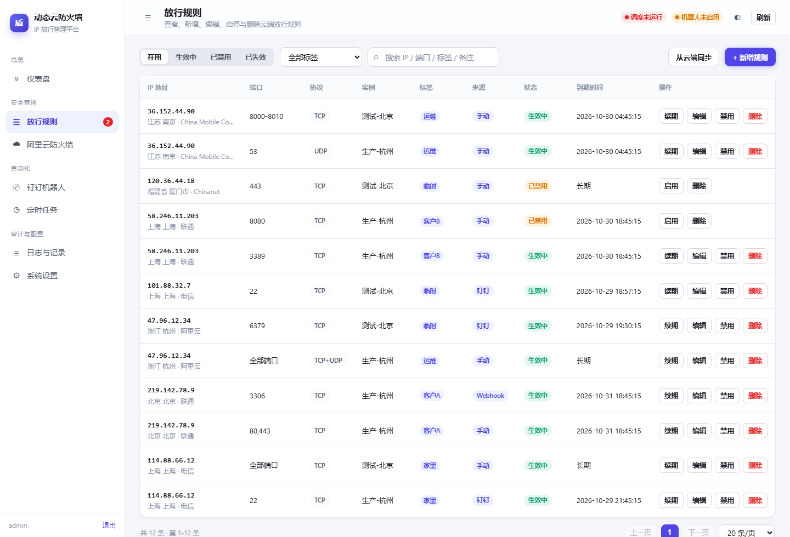
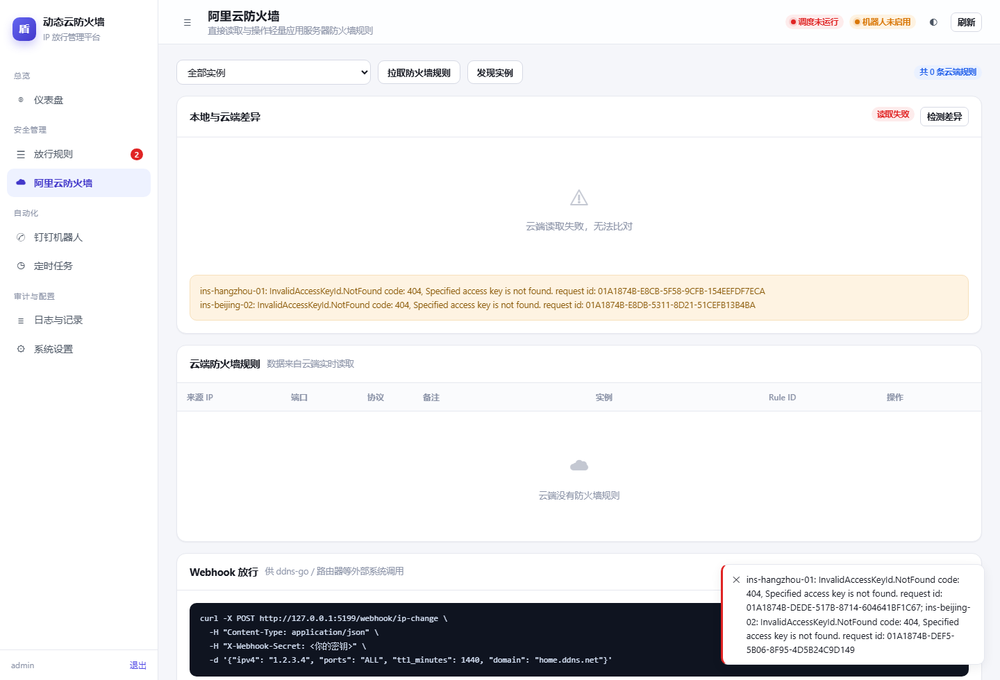
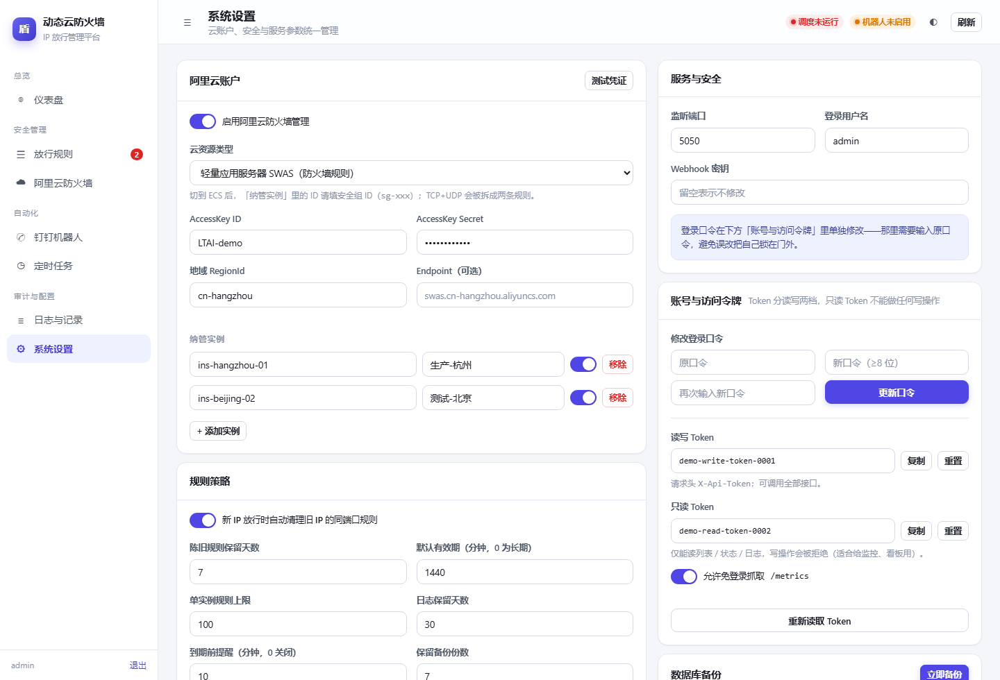
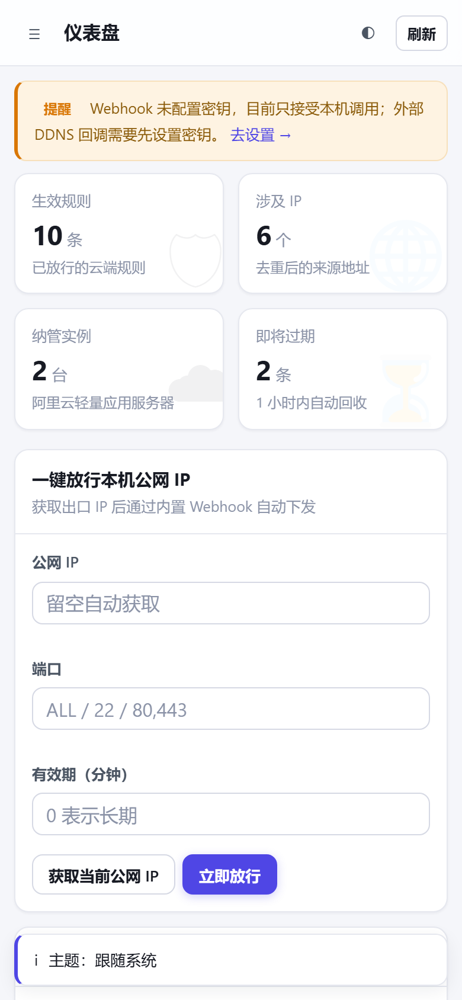

# 动态云防火墙 · IP 放行管理平台

把「临时放行一个 IP」这件事压缩成**在钉钉群里发一句话**。

> `@IP放行助手 1.2.3.4` → 阿里云轻量应用服务器防火墙自动放行全端口 → 机器人回一张结果卡片。

本项目是一个自带 Web 管理后台、内置定时任务、直连阿里云 SWAS 防火墙的轻量平台，
单进程运行，不依赖外部 cron、数据库或消息队列。

---

## 功能一览

| 模块 | 能力 |
|---|---|
| **钉钉机器人** | 群内 @机器人 发 IP 即放行；`IP` 放行全端口，`IP 端口` 只放行指定端口；支持多端口、端口段、UDP、多 IP、删除、列表、状态、**续期**；结果以卡片回执。凭证全部在 Web 端配置，**Stream 模式无需公网 IP** |
| **内置定时任务** | APScheduler 进程内调度：过期规则清理、云端规则同步、陈旧规则清理、日志归档、凭证健康检查、每日报告、**到期前提醒**、**数据库滚动备份**；Web 端可看下次执行时间、上次结果、耗时，并可「立即执行」 |
| **使用教程** | 内置「使用教程」页：三步上手、五种放行入口、钉钉指令表、公网 IP / 永久放行、Webhook 与 CLI、2FA 绑定、定时任务一览、群晖部署与常见问题，随服务一起离线可查 |
| **阿里云防火墙** | 列表 / 新增 / 编辑 / 启用 / 禁用 / 删除防火墙规则；SWAS 轻量服务器与 **ECS 安全组**双 provider 可切换；支持实例发现；一键获取本机公网 IP 并通过 Webhook 放行 |
| **Web 管理后台** | 仪表盘、规则列表（服务端分页 + 标签筛选 + IP 归属地）、云端规则、**本地/云端差异视图**、机器人配置、任务状态、操作日志、指令留痕、系统设置、**API 令牌管理**、**数据库备份** |
| **访问与界面** | 首次登录强制改口令、读写 Token 分权、**深色模式**（浅色/深色/跟随系统）、**PWA**（可安装到桌面/手机、离线兜底页）、纯标准库 **CLI 工具** |
| **公网 IP 自动放行 & 自动续期** | 动态公网 IP 不掉线：定时把当前公网 IP 同步进防火墙（IP 变了自动替换）；任意规则可开「自动续期」，到期时自动探测公网 IP 续期或跟随新 IP |


---

## 界面预览

| 浅色 · 仪表盘 | 深色 · 仪表盘 |
|---|---|
|  |  |

| 规则列表（标签 / 分页 / 归属地） | 本地与云端差异 |
|---|---|
|  |  |

| 系统设置（账号与令牌） | 手机端 |
|---|---|
|  |  |

更多截图见 `docs/screenshots/`（含深色规则页、编辑弹窗、手机端深色）。

---

## 快速开始

### 方式一：Windows 一键启动（推荐）

双击根目录的 **`start.bat`**。脚本会自动：

1. 检测 Python（3.9+）
2. 创建 `.venv` 虚拟环境
3. 用阿里云镜像安装依赖
4. 启动服务并打开提示地址

浏览器访问 <http://127.0.0.1:5050>，默认账号 `admin` / `admin123`。
首次登录会强制要求改一个新口令（8 位以上、含字母与数字），改完才能进入其他页面。

### 方式二：手动启动

```bash
python -m venv .venv
.venv\Scripts\activate          # Windows
# source .venv/bin/activate     # Linux / macOS

pip install -r requirements.txt
python run.py
```

常用参数：

```bash
python run.py --port 8080    # 覆盖端口
python run.py --no-cron      # 不启动定时任务
python run.py --no-bot       # 不启动钉钉机器人
python run.py --debug        # 调试模式
```

### 方式三：Docker

```bash
docker compose up -d --build
```

> ⚠️ 必须**单进程**运行：定时任务调度器与钉钉长连接都是进程内单例，
> 用 gunicorn 多 worker 会导致任务重复执行、长连接重复建立。

### 方式四：Linux 守护进程

```bash
sudo cp security-group-manager.service /etc/systemd/system/dcf.service
sudo systemctl daemon-reload
sudo systemctl enable --now dcf
```

---

## 首次配置（3 步）

### 1. 配置阿里云

**系统设置 → 阿里云账户**：

- AccessKey ID / Secret（建议用 RAM 子账号，仅授权 `AliyunSWASFullAccess`）
- 地域：如 `cn-hangzhou`
- 纳管实例：填轻量服务器的实例 ID（控制台实例详情页可复制），可加多个

点 **测试凭证** 验证；成功后可去「阿里云防火墙」页点 **拉取防火墙规则** 看到真实规则。

### 2. 配置钉钉

**钉钉机器人 → 应用凭证** 填入 Client ID / Client Secret / App ID / AgentId，
保存后「长连接状态」应变为 **在线**。

从 0 开始创建应用、拿凭证、发布、拉群、验证的完整步骤见
👉 **[docs/钉钉机器人部署指南.md](docs/钉钉机器人部署指南.md)**

### 3. 试一次

在群里 @机器人 发：

```
1.2.3.4
```

收到「✅ 放行成功」卡片即全部打通。

---

## 指令规范

| 发送内容 | 效果 |
|---|---|
| `1.2.3.4` | 放行全部端口 |
| `1.2.3.4 22` / `1.2.3.4:22` | 仅 TCP 22 |
| `1.2.3.4 22,80,443` | 多端口 |
| `1.2.3.4 8000-9000` | 端口段 |
| `1.2.3.4 53 udp` | 指定协议 |
| `1.2.3.4 1.2.3.5 22` | 多 IP 同端口 |
| `删除 1.2.3.4` | 撤销放行 |
| `续期 1.2.3.4 2h` | 在原到期时间上延长 2 小时（单位 `m/h/d`，不写单位按小时） |
| `列表` / `状态` / `我的IP` / `帮助` | 查询类指令 |

---

## Webhook（给 ddns-go / 路由器用）

公网 IP 变化时自动放行：

```bash
curl -X POST http://你的服务器:5050/webhook/ip-change \
  -H "Content-Type: application/json" \
  -H "X-Webhook-Secret: 你在系统设置里填的密钥" \
  -d '{"ipv4":"1.2.3.4","ports":"ALL","ttl_minutes":1440,"domain":"home.ddns.net"}'
```

支持字段：`ip` / `ipv4` / `ipv6` / `ports` / `protocol` / `ttl_minutes` / `domain`。
IPv4 与 IPv6 可在同一次请求里同时下发。

> **安全默认值**：没有在「系统设置 → Webhook」里填密钥时，`/webhook/ip-change` **只接受本机回环调用**
> （Web 端「一键放行」走的就是这条路），外部请求一律 403。
> 要让 ddns-go / 路由器调用，必须先设置密钥。

端口字段同样接受中文写法：`ALL`、`*`、`全部端口`、`全端口`、`全部`、`所有` 都会归一化成阿里云要求的 `1/65535`。

---

---

## 公网 IP 自动放行与规则自动续期

面向「家庭宽带 / 动态公网 IP」场景：IP 会变，但放行规则不该因此断掉。

### 1. 公网 IP 自动放行（默认每小时）

在「系统设置 → 公网 IP 自动放行」打开开关后，定时任务 `sync_public_ip` 默认**每小时**
（可在定时任务页改计划）把「当前公网 IP」同步进阿里云防火墙：

- 还没放过该 IP：按设置里的端口 / 协议 / 有效期创建一条来源为 `public_ip` 的规则；
- 已有同 IP 规则：只刷新有效期，不重复创建；
- IP 变了：删掉旧 IP 的规则，按新 IP 新建（自动跟随）。

这样生成的规则**自带「自动续期」**，所以两次同步之间即使到期也不会被清理掉。
IP 探测走 `app/core/iputil.py::get_public_ip()` 多源回退（ipify / ipinfo / ipip / ifconfig.me / ipw.cn），
探测失败则当轮跳过，不盲目放行也不误删。

有效期（`public_ip.ttl_minutes`）三档：

| 取值 | 含义 |
|---|---|
| 正数（分钟） | 直接使用该有效期 |
| `0` | 跟随「规则策略 → 默认有效期」 |
| `-1` | **永久放行**：不写到期时间、不参与过期回收（NAS / 固定服务器长期放行用这个） |

> **夜间关机也不怕**：调度器启动后 15 秒会检查每个「日级任务」（间隔 ≥ 12 小时的，
> 如每日 04:00 的公网 IP 同步、每日备份），只要「上次运行之后本该触发的时刻」已经过去，
> 就立刻补跑一次。所以 NAS 设了 23:00–08:00 自动关机时，凌晨的每日任务会在开机后自动补上，
> 而不是像纯 cron 那样直接跳过一整天。补跑记录在操作日志里，动作名为「启动补跑任务」。

#### 永久放行 + 动态 IP，怎么配？

「永久」和「跟随 IP」是两件独立的事，不冲突：

- `expires_at` 为空只表示**不会按到期时间回收**；
- IP 跟随由 `sync_public_ip` 每次执行时比对 `source=public_ip` 的规则完成，与是否永久无关。

但永久规则没有到期点，`auto_renew_due_rules()` 就不会处理它——**「到期时自动跟随」这条兜底路径消失了**，
IP 跟随只剩 `sync_public_ip` 这一条路。所以动态 IP 场景推荐：

| 配置项 | 取值 | 理由 |
|---|---|---|
| 有效期 | `-1`（永久） | NAS 关机多久都不会被回收，恢复即用 |
| `sync_public_ip` 计划 | `0 * * * *`（默认） | 每小时的整点检查一次，IP 变了最多个把小时跟上 |

IP 真的变化并跟随成功后，会推送一条「公网 IP 已自动跟随」钉钉通知（含旧 IP / 新 IP / 触发方式），
可在「系统设置 → 公网 IP 自动放行」里用「IP 变化时推送钉钉通知」开关关闭。
开销可以忽略：IP 未变时任务只做一次本地 `UPDATE`，**不调用任何云端接口**；只有 IP 真的变了才删旧建新。
若倾向「少写数据、只靠到期续期兜底」，就用默认的 `7200 分钟 + 自动续期（跟随）`，代价是 IP 变化
最坏要等到下一个到期点才跟随。

### 2. 规则级自动续期（逐条开关 + 续期方式二选一）

任意一条「生效中」规则都可以在规则列表的「自动续期」按钮，或编辑弹窗里的开关打开自动续期；
**打开后还能选择「续期方式」**：

- **跟随新 IP（默认）**：到期时探测本机当前公网 IP。没变就顺延有效期（云端不动）；变了就删旧规则、
  按新 IP 重建，实现家庭宽带重播号后自动跟随。适合你跑在笔记本 / 动态公网 IP 上、需要「IP 变了也不断线」的场景。
- **原 IP 续期**：无论公网 IP 是否变化，都保持规则原有 IP、仅把有效期顺延到「现在 + 默认有效期」，
  **不探测、也不碰云端**。适合固定 IP / 静态办公网段——你不想让它因为本地公网 IP 抖动而被换成别的地址。

过期清理任务每次运行都会先处理这批规则：

1. 按每条规则的「续期方式」分流；
2. **原 IP 续期**：直接顺延有效期，云端不动；
3. **跟随新 IP**：探测本机公网 IP（多探几次，避免抖动误判）。没变顺延；变了删旧建新；
4. **探测失败**（仅跟随模式）：这一轮不续期，规则仍按原逻辑被过期清理回收（宁可断开，也不盲目放开）。

> 默认有效期只在「系统设置 → 规则策略 → 默认有效期」一处配置。早期钉钉页也曾有一份
> `default_ttl_minutes`，已废弃——改了不生效就是因为它和规则策略不互通。现在钉钉页不再
> 显示该字段，所有有效期统一在规则策略里设置。

### 3. 配置入口

| 想要的效果 | 去哪设置 |
|---|---|
| 每天把当前公网 IP 同步进防火墙 | 系统设置 → 公网 IP 自动放行（开关 + 端口 / 协议 / 有效期 / 标签） |
| 某条规则到期自动续期 | 规则列表「自动续期」按钮，或编辑弹窗里的开关；续期方式在弹窗内下拉选择（原 IP 续期 / 跟随新 IP） |
| 放行默认有效期 | 系统设置 → 规则策略 → 默认有效期 |


## 内置定时任务

| 任务 ID | 默认 cron | 作用 |
|---|---|---|
| `cleanup_expired` | `*/5 * * * *` | 删除已过期的放行规则（云端 + 本地） |
| `sync_cloud_rules` | `*/15 * * * *` | 拉取云端规则修正本地镜像，识别漂移 |
| `cleanup_stale_ip` | `0 3 * * *` | 清理长期未刷新的自动规则（安全兜底） |
| `prune_logs` | `30 4 * * *` | 按保留天数清理日志与任务记录 |
| `health_probe` | `*/10 * * * *` | 校验阿里云 AccessKey 是否仍然可用 |
| `daily_report` | `0 9 * * *` | 汇总规则与任务状态推送钉钉群 |
| `expiring_notice` | `*/5 * * * *` | 到期前提醒（提前量可配，`0` 关闭） |
| `backup_db` | `0 5 * * *` | 数据库滚动备份，保留最近 N 份 |
| `sync_public_ip` | `0 * * * *` | 每小时同步当前公网 IP，IP 变了自动替换并推送通知 |

修改 cron 表达式有两种方式：

1. **定时任务页 → 卡片上的「配置计划」**（推荐，不懂 cron 也能用）：
   弹窗里选「每 N 分钟 / 每小时 / 每 N 小时 / 每天 / 每周 / 每月」，
   填数字或用时间选择器，下面实时显示中文说明与「接下来 5 次执行时间」，
   也可以直接在表达式框手动微调（会自动切到「自定义 cron」）。
2. **系统设置 → 定时任务开关**：只切换启用状态，表达式沿用原值。

保存后调度器热重载，无需重启进程。自定义表达式按标准 cron 解析：
`分 时 日 月 周`，星期 **0/7=周日，1=周一 … 6=周六**（服务端已做转换，
不会出现 APScheduler 里 0=周一 的语义错位）。

命令行/接口可用 `POST /api/cron/preview` 先校验表达式，返回中文释义与未来执行时间。

### 夜间关机 / 计划外停机

APScheduler 默认只容忍 2 分钟的 misfire，进程停机期间错过的触发点**不会自动补**。
本项目的 `SchedulerService` 在启动后 15 秒做一次补跑检查：

- 只看**日级及以下频率**的任务（相邻触发间隔 ≥ 12 小时），高频任务漏几分钟不补；
- 依据 `task_runs` 里该任务最近一次运行时间，反推「它本该在哪一刻再跑一次」；
- 该时刻已过 → 立即补跑一次（只补最近的一次，不追历史），完成后写入操作日志「启动补跑任务」。

所以「23:00 关机、08:00 开机」这种 NAS 作息，凌晨 03:00 / 04:00 / 04:30 / 05:00 的四个每日任务
会在开机后依次补上；想彻底不依赖开机时间，可以把 `sync_public_ip` 改成 `*/30 * * * *` 之类的间隔式计划。

---

## 规则的删除与恢复

「删除」是**软删除**，目的是既能反悔、又能清理：

| 操作 | 云端 | 本地记录 | 说明 |
|---|---|---|---|
| 删除 | 立即移除 | 状态改为 `deleted`，从默认列表消失 | 重复点击不会报错，云端已不存在也按成功处理 |
| 恢复到云端 | 按原 IP/端口/协议重新下发 | 回到 `active` | 云端已有同规则则直接复用，不重复创建 |
| 清理记录 | 不动 | 从数据库物理删除 | 仅对已失效记录开放，删了就不能再恢复 |

规则列表默认只看「在用」（生效中 + 已禁用）；已删除 / 已过期 / 已清理归到「已失效」，
在那里可以一条条恢复或彻底清理。

> 恢复时如果原到期时间已过，会自动改成「长期有效」，避免刚恢复就被过期清理任务回收。

---

## 规则的标签、分页与差异视图

- **标签**：新增/编辑规则时可填标签（如 `办公`、`临时会议`、`客户现场`），列表顶部按标签一键筛选。
  钉钉侧不强制填，Web 端给的是输入建议（datalist），已有标签会自动补全。
- **分页**：规则列表改为服务端分页（默认 20 条/页，可选 20/50/100），
  关键字、状态、标签、实例全部在 SQL 层过滤，几千条规则也不会把浏览器卡住。
- **差异视图**：云端规则页底部对比「本地镜像 vs 云端实际」，分三类列出
  *仅本地有*、*仅云端有*、*端口/协议不一致*。常见用途：
  有人绕过平台直接在阿里云控制台改规则，或云端删除失败留下的漂移。
- **归属地**：规则列表的 IP 列会显示「浙江 杭州 · 阿里云」这类提示，
  查询结果写入 `ip_geo` 表缓存（默认 7 天内不重复查询），断网时用缓存兜底。

---

## 到期提醒与一键续期

- `expiring_notice` 任务默认每 5 分钟扫一次，把「将在 `rules_policy.expire_notice_minutes`
  分钟内到期且尚未提醒过」的规则推送钉钉群（`notified_at` 去重，不会重复轰炸）。
- 提前量在「系统设置 → 规则策略」里改，填 `0` 关闭提醒。
- 收到提醒后三种续期方式：钉钉发 `续期 1.2.3.4 2h`、规则列表点「续期」、
  `POST /api/rules/<id>/renew`。续期是在**原到期时间**上叠加，不是从当前时间重算。

---

## 规则变更通知模板

「系统设置 → 规则变更通知」可开关，并按动作分别控制（放行/删除/续期/到期）。

模板支持占位符：`{action}` `{ip}` `{port}` `{protocol}` `{instance}` `{actor}` `{time}` `{expire}`。
占位符写错不会报错（缺失项渲染为空字符串），右侧「预览」按钮用假数据实时渲染效果。

---

## 数据库备份

- `backup_db` 任务默认每天 05:00 用 SQLite 在线备份 API（`sqlite3.backup()`）导出一份，
  **不锁库、不影响正在进行的写入**。
- 备份落在 `data/backups/app-YYYYMMDD-HHMMSS.db`，按 `logging.backup_keep` 保留最近 N 份
  （默认 7），超出的自动删最旧的。
- 系统设置页可「立即备份」并直接下载某一份；接口为 `POST /api/backup/run`、`GET /api/backups/<name>`。

---

## 监控指标

`GET /metrics` 输出 Prometheus 文本格式（默认免登录，可在设置里关掉 `server.metrics_public`）：

```
dcf_rules{status="active"} 2
dcf_rules_total 4
dcf_rule_ips 2
dcf_rules_expiring 0
dcf_task_runs_total{job_id="cleanup_expired",status="success"} 28
dcf_task_duration_ms{job_id="sync_cloud_rules"} 233
dcf_cron_running 1
dcf_dingtalk_connected 1
dcf_instances 1
dcf_logs_total 68
dcf_uptime_seconds 98
```

适合直接挂到 Prometheus / Grafana，或先用 `curl` 看一眼。

---

## 访问控制：首次改密与令牌分权

- **首次登录强制改密**：还在用默认口令 `admin123` 时，登录后所有业务接口返回 `428`
  并弹出改密浮层，只放行 `/api/me`、`/api/account/*` 等逃生接口。
  口令要求 8 位以上且至少包含字母与数字，弱口令（含与用户名相同）会被拒。
- **两种 API Token**：
  | Token | 用途 | 写接口 | 读接口 |
  |---|---|---|---|
  | `api_token`（读写） | CLI、自动化脚本 | ✅ | ✅ |
  | `api_token_readonly`（只读） | 监控、看板 | ❌ 403 `READONLY_TOKEN` | ✅ |
- 令牌在「系统设置 → 账号与访问令牌」查看/轮换，页面默认打码。

---

## 二次验证（2FA）

在口令 / Token 之上叠加一层 **TOTP 动态口令**（RFC 6238，30 秒一换、6 位数字），保护高敏感动作。
算法在 `app/core/twofa.py` 用标准库实现，二维码由纯 Python 的 `segno` 渲染（已写入 `requirements.txt`，零额外依赖）。

**配置入口**：系统设置 →「二次验证 (2FA)」。

- **自定义密钥**：点「生成新密钥」自动生成，或粘贴自有 Base32 密钥（`PUT /api/2fa/secret`，非法格式返回 `INVALID_SECRET`）。
- **扫码绑定**：把 `otpauth://` 链接渲染成内联 SVG 二维码，认证器 App 扫描即可；下方同时显示明文密钥便于手动添加。
- **适用范围**（逐项开关，`PUT /api/2fa/config`）：

  | 场景 | 触发点 | 携带方式 |
  |---|---|---|
  | 网页登录 `web_login` | `POST /api/login` | 请求体 `otp`，登录页收到 `TOTP_REQUIRED` 后自动展开输入框 |
  | Webhook 放行 `webhook` | `POST /webhook/ip-change` | 请求头 `X-2FA-Code`（或 body `otp`） |
  | 钉钉机器人 `dingtalk` | 放行 / 删除 / 续期 指令 | 消息里附带 `code=123456` 或 `#123456` |

- **机器人严格模式**（`twofa.dingtalk_all`）：关闭时只拦放行 / 删除 / 续期，只读指令（帮助 / 列表 / 状态 / 我的 IP）免口令；开启后**所有指令**都要口令。
- **Webhook 白名单**：`twofa.webhook_skip_private` 开启后，来自内网 / 回环的请求免 2FA；`twofa.webhook_trusted_cidrs` 可再列出受信任网段（如 `127.0.0.1/32, 192.168.0.0/16`），命中即跳过。
- 启用前必须先配置密钥，否则返回 `NO_SECRET`，避免把自己锁在门外；校验允许 ±1 个周期（`twofa.window`）的时钟漂移，比较用 `hmac.compare_digest`。

**核心接口**（需登录或写 Token）：`GET /api/2fa/status`、`POST /api/2fa/generate`、`PUT /api/2fa/secret`、
`GET /api/2fa/qrcode`、`POST /api/2fa/verify`、`PUT /api/2fa/config`。

---

## ECS 安全组

`aliyun.provider` 切换为 `ecs` 后，平台改走 ECS 安全组接口（`app/cloud/ecs.py`），
与 SWAS 共用同一套上层逻辑（`build_client()` 工厂按配置返回不同 provider）。

差异点（已在代码里处理）：

- ECS 一条「TCP+UDP」需要拆成两条安全组规则，内部用 `proto|port|cidr` 做复合 `rule_id`；
- ECS 没有「启用/禁用单条规则」的语义，调用会抛 `CloudError`，上层自动降级为
  「删除 + 本地留快照，可一键恢复」；
- 实例条目需额外填 `security_group_id`。

```bash
pip install alibabacloud_ecs20140526   # 仅在用 ecs provider 时需要
```

---

## 命令行程工具（CLI）

`cli.py` 纯标准库实现（只用 `urllib`），不需要装依赖，适合放进 crontab 或 CI：

```bash
export DCF_SERVER=http://127.0.0.1:5050
export DCF_TOKEN=<系统设置里复制的 Token>

python cli.py status                 # 概览 + 配置风险提示
python cli.py list --tag 办公        # 规则列表（支持 --status/--keyword/--json）
python cli.py allow 1.2.3.4 22 --ttl 60 --instance c05384...
python cli.py deny 1.2.3.4           # 删除（软删除）
python cli.py renew 1.2.3.4 2h
python cli.py tags
python cli.py diff                   # 本地 vs 云端
```

只读 Token 也能跑 `status/list/tags/diff`，但 `allow/deny/renew` 会被服务端拒（403）。

---

## 深色模式与 PWA

- 顶栏右侧的圆形按钮循环切换 **浅色 → 深色 → 跟随系统**，选择存在 `localStorage`；
  首屏在 `<head>` 里内联执行，避免刷新时白屏闪一下。
- 已接入 PWA：`manifest.webmanifest` + `service-worker.js`（scope 为根）。
  Chrome/Edge 地址栏会出现「安装」，安卓/iOS 可加到主屏幕；
  离线时打开会落到 `offline.html`，不会白屏。
- 静态资源走 **网络优先**（失败才读缓存），升级后不会因为缓存拿到旧版页面。

---

## 钉钉回复的两种形态

不是所有回复都该是卡片。程序会按内容自动选：

- **纯文本（`msgtype=text`）**：放行成功、删除成功、我的 IP、报错、看不懂的指令。
  这类信息量小，用纯文本更清爽，也不会被钉钉当成结构化文本渲染
  （否则 IP 会被行内反引号包成蓝色代码块）。
- **Markdown 卡片**：`帮助`、`列表`、`状态`，以及放行失败/多实例明细等需要分行的场景。

判断逻辑在 `app/dingtalk/render.py`：返回 `PlainText` 即走纯文本，普通字符串走 markdown 卡片。

---

## 配置管理说明

- 所有配置统一存在 **`data/app.db`（SQLite）**，由 Web 端维护，修改后即时生效。
- 每次保存都会同步一份可读副本到 **`data/settings.json`**（权限 600），
  方便查看、备份与版本比对；删掉 `data/app.db` 后重启，平台会自动从该文件恢复配置。
- 首次启动会自动把根目录旧的 `config/config.yaml` + `.env` 迁移进配置中心
  （阿里云 AK、实例列表、端口等），之后 **`config/config.yaml` 不再被读取**。
- 密钥类字段在页面上打码显示；**留空保存 = 保持原值**，不会被清空。
- `data/` 与 `.env` 已加入 `.gitignore`，请勿提交到代码仓库。
- 备份只需要拷走 `data/` 目录。

---

## HTTP API

除 `/health`、`/webhook/*`、`/dingtalk/callback` 外都需要登录会话，
或带 `X-Api-Token` 请求头（Token 在「系统设置」页可查，页面显示为打码值）。

| 方法 | 路径 | 说明 |
|---|---|---|
| GET | `/health` | 健康检查 |
| GET | `/metrics` | Prometheus 指标（`server.metrics_public=false` 时需登录） |
| POST | `/api/login` | 登录（同源连续 5 次失败锁定 5 分钟） |
| GET | `/api/overview` | 仪表盘聚合数据（含 `security_warnings` 配置风险提示） |
| GET | `/api/rules` | 本地规则列表（`page` / `page_size` / `status` / `keyword` / `tag` / `instance_id`，返回 `{items,total,page,pages}`） |
| GET | `/api/tags` | 已使用的标签及计数（用于筛选下拉） |
| POST | `/api/rules` | 新增规则（支持 `instance_ids` 多实例、`tag`、`ports` 多端口） |
| PUT | `/api/rules/<id>` | 编辑规则（多端口会按端口拆成多条） |
| DELETE | `/api/rules/<id>` | 删除规则（云端删除 + 本地软删除，可恢复） |
| POST | `/api/rules/<id>/restore` | 把软删除的记录重新下发到云端 |
| DELETE | `/api/rules/<id>/purge` | 从本地数据库彻底移除历史记录（不动云端） |
| POST | `/api/rules/<id>/toggle` | 启用 / 禁用 |
| POST | `/api/rules/<id>/renew` | 单条续期（`minutes`） |
| POST | `/api/rules/renew` | 批量续期（`ids` / `minutes`） |
| GET | `/api/cloud/rules` | 实时读取云端规则 |
| GET | `/api/cloud/diff` | 本地镜像与云端逐实例比对（`only_local` / `only_cloud` / `changed`） |
| POST | `/api/cloud/sync` | 全量同步云端规则到本地 |
| GET | `/api/cloud/instances` | 发现账号下的实例 |
| POST | `/api/cloud/rule-action` | 对云端规则执行 update/delete/enable/disable |
| POST | `/api/geo/lookup` | IP 归属地查询（带 `ip_geo` 缓存） |
| GET | `/api/ip/current` | 探测本机公网 IP |
| POST | `/api/ip/allow` | 一键获取 IP 并放行（内部走 webhook） |
| GET | `/api/cron/status` | 调度器与任务状态（含 `cron_desc` 中文释义） |
| POST | `/api/cron/preview` | 校验 cron 表达式，返回中文说明 + 未来 5 次执行时间 |
| PUT | `/api/cron/jobs/<job_id>` | 保存单个任务的 cron / 开关，并热重载调度 |
| POST | `/api/cron/<job_id>/run` | 立即执行任务 |
| POST | `/api/cron/reload` | 重载调度 |
| GET | `/api/logs` | 操作日志 |
| GET | `/api/bot/messages` | 机器人指令记录 |
| GET | `/api/account/status` | 当前账号状态（是否需要改密、是否仍是默认口令） |
| POST | `/api/account/password` | 修改口令（改密接口本身不受「强制改密」拦截） |
| GET | `/api/account/tokens` | 查看读写 / 只读 Token（仅会话可用） |
| POST | `/api/account/tokens/rotate` | 轮换 Token（仅会话可用） |
| POST | `/api/backup/run` | 立即备份数据库 |
| GET | `/api/backups` | 备份列表 |
| GET | `/api/backups/<name>` | 下载某份备份 |
| GET/PUT | `/api/settings` | 读写配置 |
| POST | `/webhook/ip-change` | 外部 IP 变更回调 |

---

## 项目结构

```
dynamic-cloud-firewall/
├── run.py                     # 统一入口（Web + 调度器 + 机器人）
├── cli.py                     # 命令行工具（纯标准库，用 API Token 调接口）
├── start.bat                  # Windows 一键启动
├── requirements.txt
├── app/
│   ├── settings.py            # 配置中心（含旧 yaml 迁移）
│   ├── store.py               # SQLite 存储层（含老库列迁移）
│   ├── cloud/
│   │   ├── factory.py         # provider 工厂 build_client()（swas / ecs）
│   │   ├── swas.py            # 阿里云 SWAS 防火墙
│   │   └── ecs.py             # 阿里云 ECS 安全组
│   ├── core/
│   │   ├── rules_service.py   # 放行规则业务逻辑（唯一写云入口）
│   │   ├── notifier.py        # 规则变更通知（模板 + 开关）
│   │   ├── geo.py             # IP 归属地查询与缓存
│   │   └── iputil.py          # 公网 IP 探测
│   ├── dingtalk/
│   │   ├── parser.py          # 指令解析（含续期时长）
│   │   ├── render.py          # 回执卡片渲染
│   │   ├── client.py          # 开放平台 API（token / 发送 / 回执）
│   │   └── bot.py             # Stream 长连接 + 消息处理
│   ├── cron/
│   │   ├── scheduler.py       # APScheduler 封装
│   │   ├── cronexpr.py        # cron 校验 / 中文释义 / 下次执行
│   │   └── jobs.py            # 8 个内置任务
│   ├── web/app.py             # Flask 路由（仅 API）
│   ├── web/metrics.py         # Prometheus 指标拼装（/metrics）
│   ├── static/                # index.html / login.html / style.css / app.js
│   │                          # manifest.webmanifest / service-worker.js / offline.html
│   └── providers/             # 旧版多云 provider（保留，默认不启用）
├── config/config.yaml.example # 旧版配置模板（仅首次迁移用）
├── data/app.db                # 运行时生成：配置 + 规则镜像 + 日志
├── data/backups/              # 定时备份
├── docs/钉钉机器人部署指南.md
└── scripts/
    ├── test_suite.py          # 完整测试套件（假云端，99 个用例）
    └── smoke_test.py          # 冒烟自检（71 项）
```

---

## 测试

两套互补的检查，都不触碰真实云端：

```bash
python scripts/test_suite.py      # 完整测试：假云端 + 假凭证，覆盖业务全生命周期
python scripts/test_suite.py -k webhook   # 只跑名字含 webhook 的用例
python scripts/smoke_test.py      # 冒烟自检：配置迁移 / 指令解析 / 调度装配 / Web 接口
```

`test_suite.py` 会在临时目录建库、劫持配置路径，**不会读写 `data/app.db`，也不会读到真实 AccessKey**。
它用一个内存版 SWAS 客户端模拟真实 API 的约束（`Port` 必须是 `start/end`、删除不存在的
`rule_id` 返回 404 等），所以线上踩过的 400/404 都能在本地复现。

当前规模：`test_suite.py` **99 个用例**、`smoke_test.py` **71 项检查**，全部通过。
其中包含一条老库升级回归：模拟没有 `tag` / `notified_at` 列的旧数据库，
要求 `Store()` 能自动补列并建好索引（早期版本会因建索引早于补列直接启动失败）。

---

## 已知边界

- **云平台边界**：目前支持阿里云 SWAS 防火墙与 ECS 安全组；腾讯云 / AWS / 华为云仍是 v1 遗留 provider，未接入新链路。
- **ECS 差异**：安全组没有单条规则启停语义，禁用会降级为「删除 + 快照」；TCP+UDP 会拆成两条规则，`rule_id` 为复合键。
- **启用/禁用**：优先使用云端 `EnableFirewallRule` / `DisableFirewallRule`；若云端不支持，
  自动降级为「删除规则 + 本地留快照，可一键恢复」。
- **删改规则**：`ModifyFirewallRule` 失败时自动回退「删除后重建」，`rule_id` 会变化（程序会重新定位并回写）。
- **HTTP 回调模式**：仅做时间戳签名校验，不实现 AES 消息体解密；生产环境强烈建议用 Stream 模式。
- **单进程**：调度器与长连接不可多实例，横向扩展需外部化任务与连接管理。
- **登录安全**：同一来源连续 5 次密码错误会锁定 5 分钟；口令与 API Token 均为定长比较。
  仍是默认口令 `admin123` 时，登录后会被强制改密（业务接口返回 `428`），改完立即解除。
- **只读 Token 的边界**：只读 Token 能读配置、规则、日志与指标，但读不到 Token 明文本身
  （`/api/account/tokens` 仅限会话），也改不了任何东西。
- **遗留代码**：`app/providers/`、`app/handlers/`、`app/api/cache_management.py` 是 v1 多云版本遗留，
  新链路不引用（仅在保存配置时 try-import 清缓存）。确认不再需要多云后可整目录删除，约 3.2k 行。

---

## License

MIT
